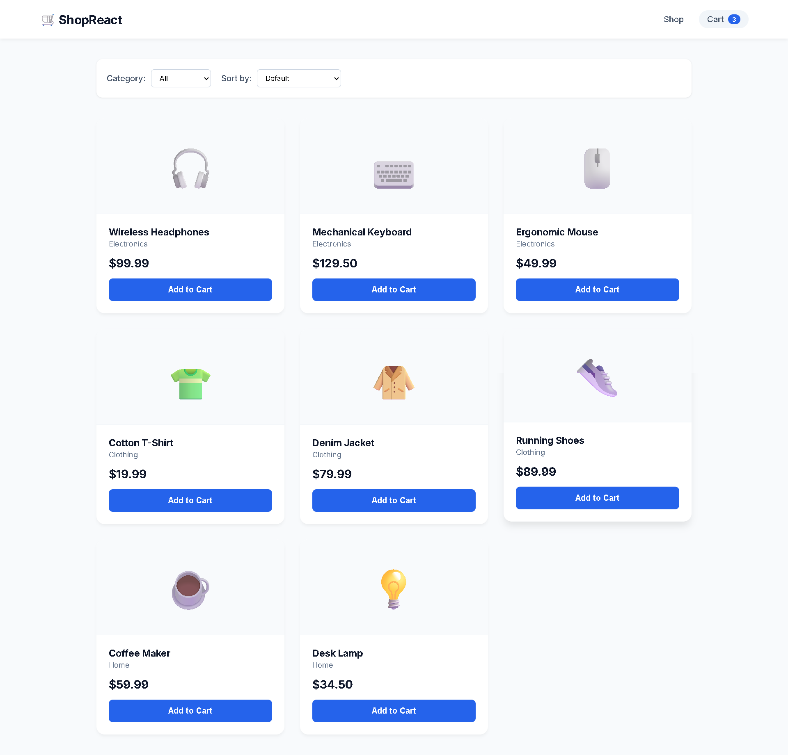

# React E-Commerce Catalog


A modern, fully functional E-Commerce storefront built with React. This is Project 5 of my 10-project developer portfolio series.



## 🚀 Live Demo

**[View the Live Website Here](https://steady-gumption-53f4c5.netlify.app)**

## 📖 About The Project

This project is a fully responsive product catalog that simulates a real-world e-commerce shopping experience. 

The primary goal was to master **React Router** for multi-page navigation, **complex state management**, and **micro-interactions**. It demonstrates how to share a shopping cart state across multiple components, dynamically filter/sort products, provide instant user feedback via toast notifications, and handle a complete checkout flow.

## ✨ Key Features

*   **Complete Shopping Journey:** From browsing the catalog, to adding items, to a fully designed checkout page and order confirmation screen.
*   **Toast Notifications:** Custom-built sliding toast notifications that appear when an item is successfully added to the cart.
*   **Interactive UI Feedback:** The "Add to Cart" button visually changes state (turns green and reads "Added!") to confirm the user's action.
*   **Multi-Page Routing:** Uses `react-router-dom` to switch between the Shop, Cart, and Checkout pages without full page reloads.
*   **Shopping Cart State:** Global state management allowing users to add items, remove items, and calculate the total price dynamically.
*   **Dynamic Filtering & Sorting:** Users can filter products by category and sort them by price.
*   **Responsive Layout:** A clean CSS Grid layout that adapts to mobile and desktop screens.

## 🛠️ Tech Stack

*   **React (v18+):** Functional components, `useState`, Props, and Context/Routing.
*   **React Router DOM (v6):** For client-side routing (`/`, `/cart`, `/checkout`).
*   **Vite:** For fast development and building.
*   **CSS3:** CSS Grid, Flexbox, keyframe animations (Toast slide-up), and custom form controls.

## ⚙️ How to Run Locally

1. Clone the repository:
   ```bash
   git clone https://github.com/waseemqureshi2020/ecommerce-catalog.git